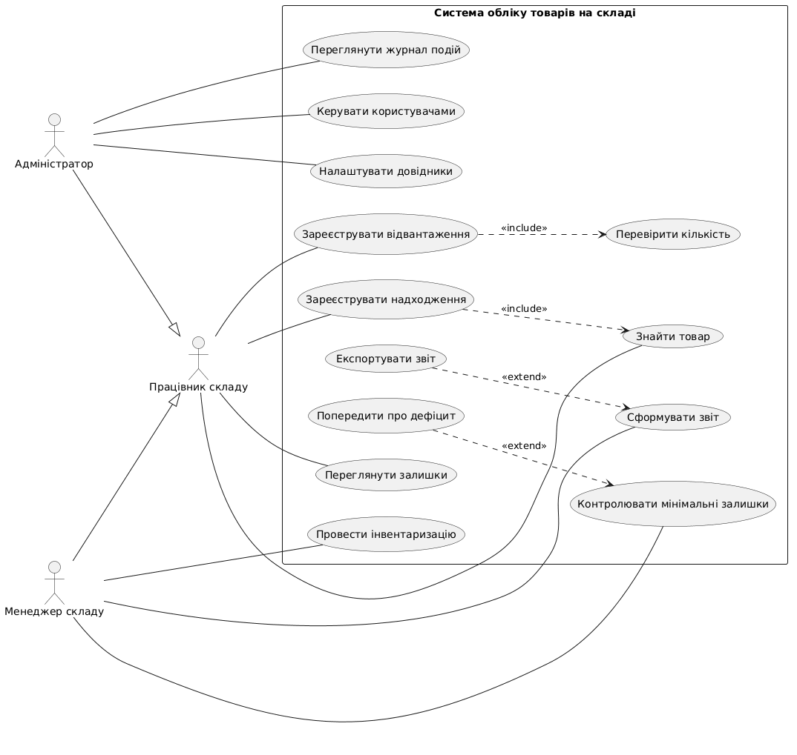
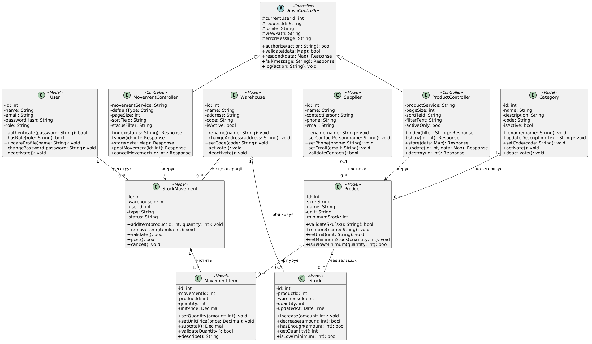

# Архітектура системи обліку товарів на складі

## Предметна галузь
Вебсистема на PHP/Laravel (MVC) підтримує облік товарів, категорій, постачальників, складів, залишків, надходжень та відвантажень. Ролі: працівник складу, менеджер складу й адміністратор.

Основні сутності/таблиці: User/users, Product/products, Category/categories, Supplier/suppliers, Warehouse/warehouses, Stock/stocks, StockMovement/stock_movements, MovementItem/movement_items.

## Ключовий Use Case: Зареєструвати відвантаження товарів
**Scope:** System. **Level:** User-goal. **Primary actor:** Працівник складу.

**Stakeholders and interests:** Працівник — швидке оформлення; менеджер — точні залишки; організація — контроль руху.

**Preconditions:** Авторизований користувач із правом відвантаження, наявний склад і товари.

**Success guarantee:** Підтверджений документ створено, залишки атомарно оновлено.

**Main Success Scenario:**
1. Відкрити «Рух товарів».
2. Вибрати «Нове відвантаження».
3. Отримати форму.
4. Обрати склад.
5. Переглянути товари складу.
6. Знайти товар.
7. Додати товар у документ.
8. Зазначити кількість.
9. Перевірити залишок.
10. Переглянути перелік позицій.
11. Натиснути «Підтвердити».
12. Повторно перевірити та транзакційно зберегти зміни.
13. Отримати номер документа.

**Extensions:** Немає складу; товар не знайдено; кількість ≤ 0; недостатній запас; документ без позицій; залишок змінився паралельно; збій БД із відкатом.

**Special Requirements:** Контроль ролей, транзакції, заборона від’ємних залишків, журналювання.

**Technology and Data Variations List:** Ручне введення SKU або сканер штрихкодів.

**Frequency of Occurrence:** Щодня (орієнтовно).

**Miscellaneous:** Уточнити правила скасування підтверджених операцій.

## UML-діаграми

Вихідний код: `use-case.puml` та `class-diagram.puml`.
